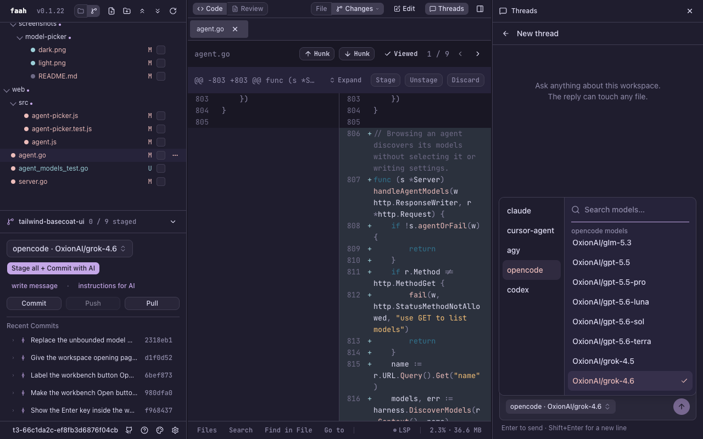
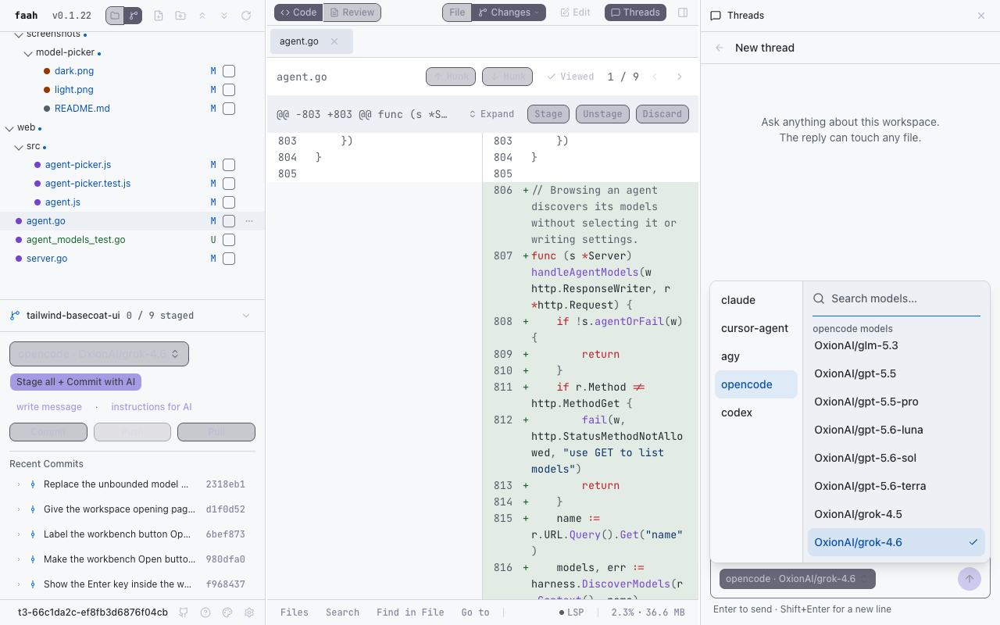
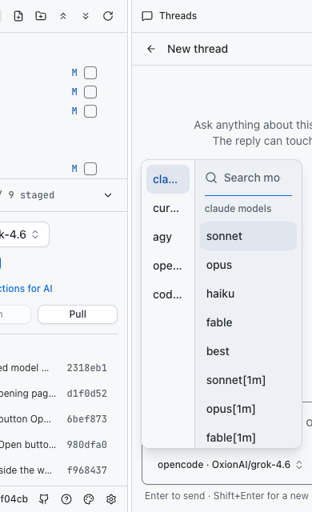

# Agent and model picker

Captured from the running app with its local catalogue of 523 models. The
agent column stays independent; search filters only the active agent's
models. Model labels preserve the exact names returned by each agent, including provider prefixes. Both columns scroll within a popover constrained to its containing panel and the viewport. Browsing an agent discovers its real models without saving a selection; failures show an error and Retry, never a fabricated model. All surfaces, text and
selection colors come from the current theme.

Validation: agent/model grouping and search unit tests; browser checks for
search, no results, exact selection payload (intercepted to avoid changing saved
settings), keyboard selection, Escape/focus restoration, on-demand discovery without changing the selection, and panel/viewport containment
at 1280×800 and 390×640. Frontend checks, Go tests and desktop tests passed.
